# HW-16 --- OTA Updates Testing (Smart Lamp)

## Test environment

-   DUT: ESP32-S3 DevKit
-   Initial firmware: `station_WiFi_v1.3.0_merged.bin`
-   UART: 115200 8N1
-   Wi-Fi: 2.4 GHz `Test-WiFi`
-   Tested firmware path: `v1.3.0 -> v1.4.0 -> v1.5.0`
-   Firmware transitions after the initial flash were performed through
    OTA.
-   Physical RGB LED behavior was checked visually.
-   Wi-Fi passwords are redacted as `***` in submitted logs.

## 1. Checklist by firmware version

### v1.3.0

| Check | PRD | Result |
|---|---|---|
| Initial firmware/version/partition state | OTA-1 | PASS |
| OTA channel/version information | OTA-2 | PASS |
| Named lamp colors | FR-L2, FR-L4 | **FAIL — BUG-01** |
| Arbitrary RGB and invalid RGB/color input | FR-L3 | PASS |
| Brightness 0–100 and range validation | FR-L5 | **FAIL — BUG-02** |
| `solid`, `blink`, `breathe` modes | FR-L6 | PASS |
| `rainbow` unavailable in 1.3.0 | FR-L6 / version limitations | PASS — expected not implemented |
| Lamp timer | FR-L7 | Logical timer behavior PASS; physical OFF **FAIL — BUG-03** |
| `lamp status` | FR-L8 | PASS |
| Lamp settings persistence after reboot | FR-L9 | PASS |
| Lamp is logically OFF after reboot | FR-L1 | Logical state PASS; physical OFF **FAIL — BUG-03** |
| Scenes | FR-L10 / version limitations | PASS — expected not implemented |
| Negative lamp input validation | FR-L5, FR-L6, FR-L7, FR-L10, FR-L11 | PASS except brightness range validation — BUG-02 |
| OTA without Wi-Fi | OTA-7 | PASS |
| Wi-Fi interruption during OTA | OTA-6 | Download interruption detected correctly |
| Retry OTA after reconnect without reboot | OTA-6 | **FAIL — BUG-04** |
| OTA `1.3.0 -> 1.4.0` | OTA-3, OTA-5 | PASS |
| PENDING_VERIFY -> self-check -> VALID | OTA-9 | PASS |
| Configuration persistence `1.3.0 -> 1.4.0` | OTA-8 | PASS |

### v1.4.0

| Check | PRD | Result |
|---|---|---|
| Firmware/version/partition state | OTA-1 | PASS |
| OTA channel/version information | OTA-2 | PASS |
| Named lamp colors | FR-L2, FR-L4 | PASS — BUG-01 fixed |
| Arbitrary RGB and invalid RGB/color input | FR-L3 | PASS |
| Brightness and range validation | FR-L5 | PASS — BUG-02 fixed |
| `solid`, `blink`, `breathe` modes | FR-L6 | PASS |
| `rainbow` unavailable in 1.4.0 | FR-L6 / version limitations | PASS — expected not implemented |
| Lamp timer | FR-L7 | Logical timer behavior PASS; physical OFF **FAIL — BUG-03** |
| `lamp status` | FR-L8 | PASS |
| Scenes | FR-L10 / version limitations | PASS — expected not implemented |
| OTA without Wi-Fi | OTA-7 | PASS |
| Wi-Fi interruption during OTA | OTA-6 | PASS |
| Retry OTA after reconnect without reboot | OTA-6 | PASS — BUG-04 fixed |
| OTA `1.4.0 -> 1.5.0` | OTA-3, OTA-5 | PASS |
| PENDING_VERIFY -> self-check -> VALID | OTA-9 | PASS |
| Configuration persistence `1.4.0 -> 1.5.0` | OTA-8 | **FAIL — BUG-05** |

### v1.5.0

| Check | PRD | Result |
|---|---|---|
| Firmware/version/partition state | OTA-1 | PASS |
| OTA channel/version information | OTA-2 | PASS |
| Named lamp colors | FR-L2, FR-L4 | PASS |
| Arbitrary RGB and invalid RGB/color input | FR-L3 | PASS |
| Brightness and range validation | FR-L5 | PASS |
| `solid`, `blink`, `breathe`, `rainbow` modes | FR-L6 | PASS |
| Lamp timer | FR-L7 | Logical timer behavior PASS; physical OFF **FAIL — BUG-03** |
| `lamp status` | FR-L8 | PASS |
| Scenes save/load | FR-L10 | PASS |
| Invalid scene number and empty scene handling | FR-L10 | PASS |
| Scene persistence after reboot | FR-L10 / persistence | PASS |
| Lamp settings persistence after ordinary reboot | FR-L9 | PASS |
| Wi-Fi credentials persistence after ordinary reboot | Persistence | PASS |
| OTA without Wi-Fi | OTA-7 | PASS |
| Wi-Fi interruption during forced reinstall | OTA-6 | Download interruption detected correctly |
| Retry OTA after reconnect without reboot | OTA-6 | **FAIL — BUG-04 regression** |
| Downgrade without `force` | OTA-4 | PASS — downgrade blocked |
| Downgrade with `force` | OTA-4 | PASS — `1.5.0 -> 1.3.0` installed |
| Broken firmware rollback | OTA-10 | PASS |
| PENDING_VERIFY / self-check handling | OTA-9, OTA-10 | PASS |

## 2. Bug reports

### BUG-01 --- Physical RGB output has Red and Green channels swapped

-   **Found in:** v1.3.0
-   **Also tested in:** v1.4.0 --- fixed; v1.5.0 --- fixed
-   **Severity:** Major
-   **Priority:** High
-   **PRD:** FR-L2, FR-L4
-   **Preconditions:** v1.3.0 running; Smart Lamp available.
-   **Steps to reproduce:**
    1.  Run `lamp on`.
    2.  Run `lamp color red`.
    3.  Observe UART/status and physical RGB LED.
    4.  Repeat with `green`, `purple`, and `cyan`.
-   **Expected:** physical color matches the requested RGB color.
-   **Actual:** logical RGB values are correct, but physical Red and
    Green channels are swapped. For example, requested red is physically
    green and requested green is physically red. Blue is correct.
-   **Reproducibility:** reproduced repeatedly on v1.3.0.
-   **Evidence:**
    `evidence/BUG-01_red_command_physical_green_v1.3.0.jpg`

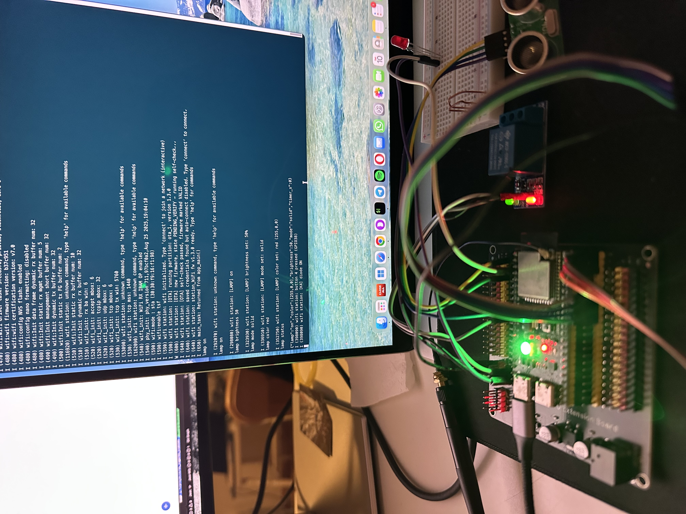

-   **Status:** Fixed in v1.4.0 and remains fixed in v1.5.0.

### BUG-02 --- Brightness values outside 0--100% are accepted

-   **Found in:** v1.3.0
-   **Also tested in:** v1.4.0 --- fixed; v1.5.0 --- fixed
-   **Severity:** Minor
-   **Priority:** Medium
-   **PRD:** FR-L5
-   **Preconditions:** v1.3.0 running; lamp enabled.
-   **Steps to reproduce:**
    1.  Run `lamp brightness 101`.
    2.  Run `lamp status`.
    3.  Run `lamp brightness -5`.
    4.  Observe UART output and physical LED behavior.
-   **Expected:** values outside 0--100 are rejected with
    `error: brightness must be 0-100`.
-   **Actual:** v1.3.0 accepts both upper and lower out-of-range values.
    `101` is stored as `"brightness":101`, and `-5` is accepted with
    `[LAMP] brightness set: -5%` instead of a validation error.
-   **Reproducibility:** reproduced with both positive and negative
    out-of-range values on v1.3.0.
-   **Evidence:**
    -   `evidence/BUG-02_brightness_101_v1.3.0.png`
    -   `evidence/BUG-02_negative_brightness_v1.3.0.png`

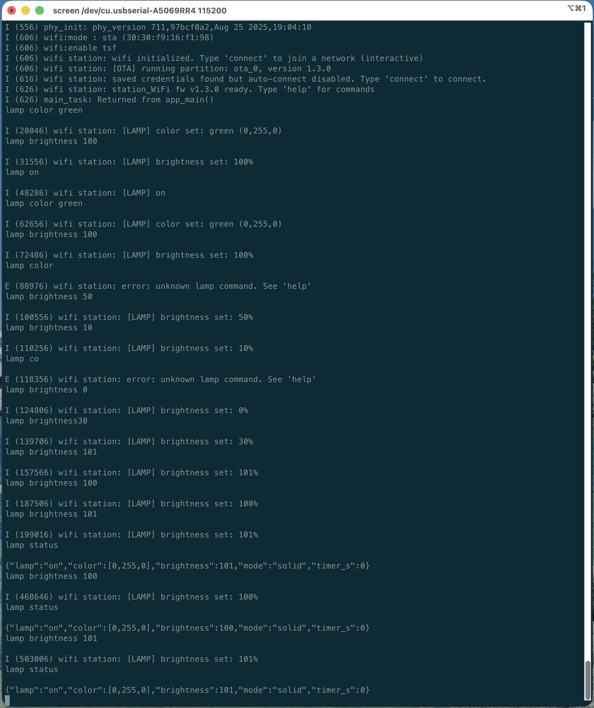
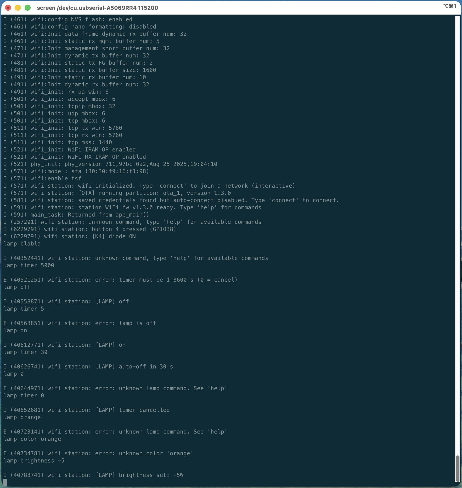

-   **Status:** Fixed in v1.4.0 and v1.5.0; both return
    `error: brightness must be 0-100`.

### BUG-03 --- Physical RGB LED does not return to the expected Wi-Fi indication when Smart Lamp is off

-   **Found in:** v1.3.0
-   **Reproduces in:** v1.4.0 and v1.5.0
-   **Severity:** Major
-   **Priority:** High
-   **PRD:** FR-L1, FR-L7, FR-W6.
-   **Preconditions:** lamp is physically on.
-   **Steps to reproduce:**
    1.  Set a visible color and turn the lamp on.
    2.  Run `lamp off`, or set `lamp timer 5` and wait for expiration.
    3.  Run `lamp status`.
    4.  Observe the physical RGB LED.
-   **Expected:** Smart Lamp logical output becomes `off`. When the lamp
    is off and LED control is in auto mode, the physical RGB LED returns
    to the Wi-Fi indication defined by FR-W6 (dim green when connected,
    dim red when disconnected), rather than continuing to display the
    previous Smart Lamp output.
-   **Actual:**
    -   v1.3.0: status reports OFF but physical LED remains red.
    -   v1.4.0: status reports OFF but physical LED remains red.
    -   v1.5.0: logical lamp state is OFF, but the physical LED can
        remain blue instead of returning to the expected Wi-Fi
        indication.
-   **Reproducibility:** repeatedly reproduced using direct OFF and
    timer expiration.
-   **Evidence:**
    -   `evidence/BUG-03_lamp_off_physical_LED_red_v1.3.0.jpg`
    -   `evidence/BUG-03_physical_red_LED_after_timer_v1.3.0.jpg`
    -   `evidence/BUG-03_timer_expired_LED_stays_red_v1.3.0.png`
    -   `evidence/BUG-03_lamp_off_physical_LED_red_v1.4.0.jpg`
    -   `evidence/BUG-03_lamp_off_physical_LED_stays_blue_v1.5.0.jpg`

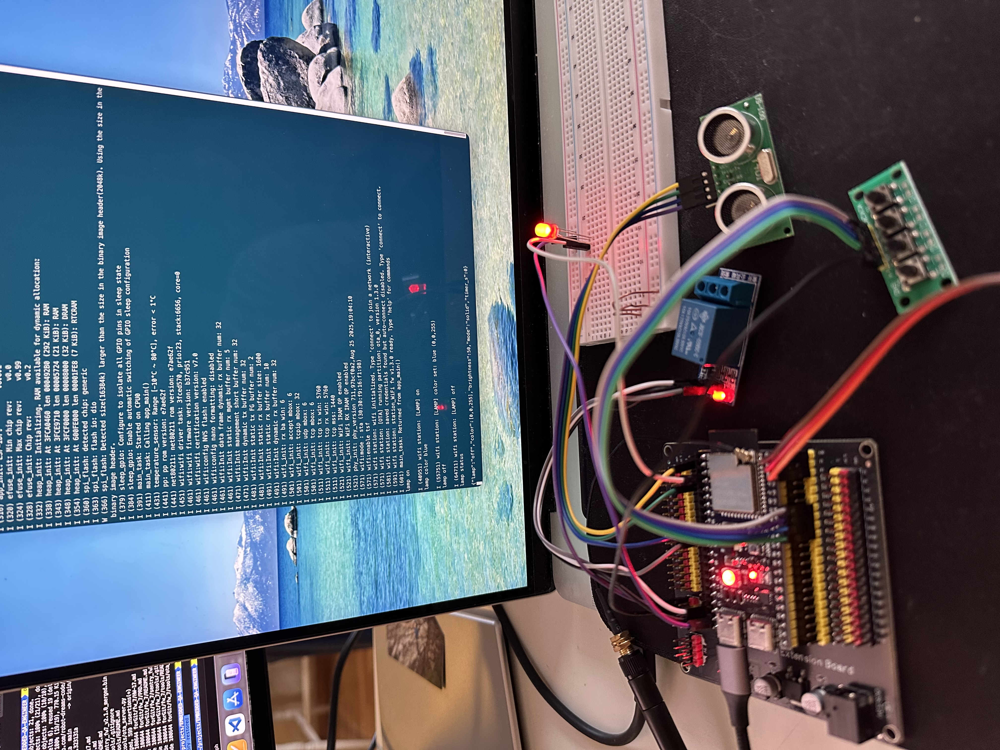
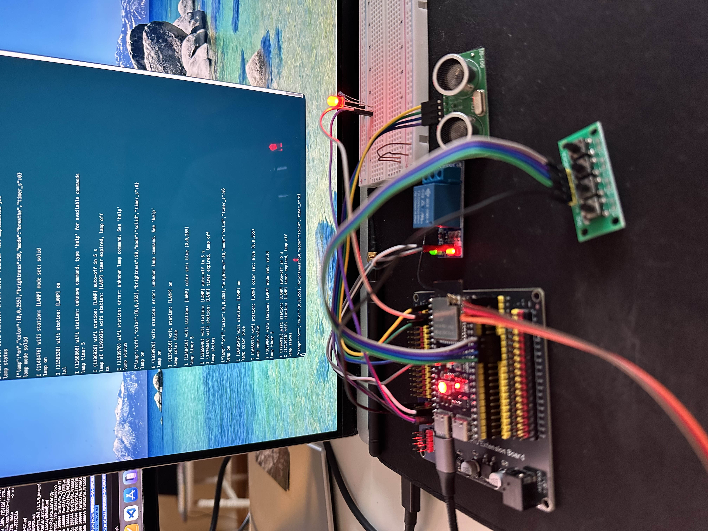
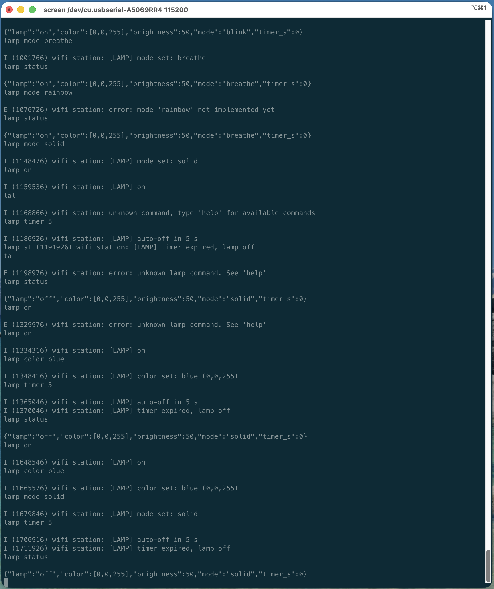
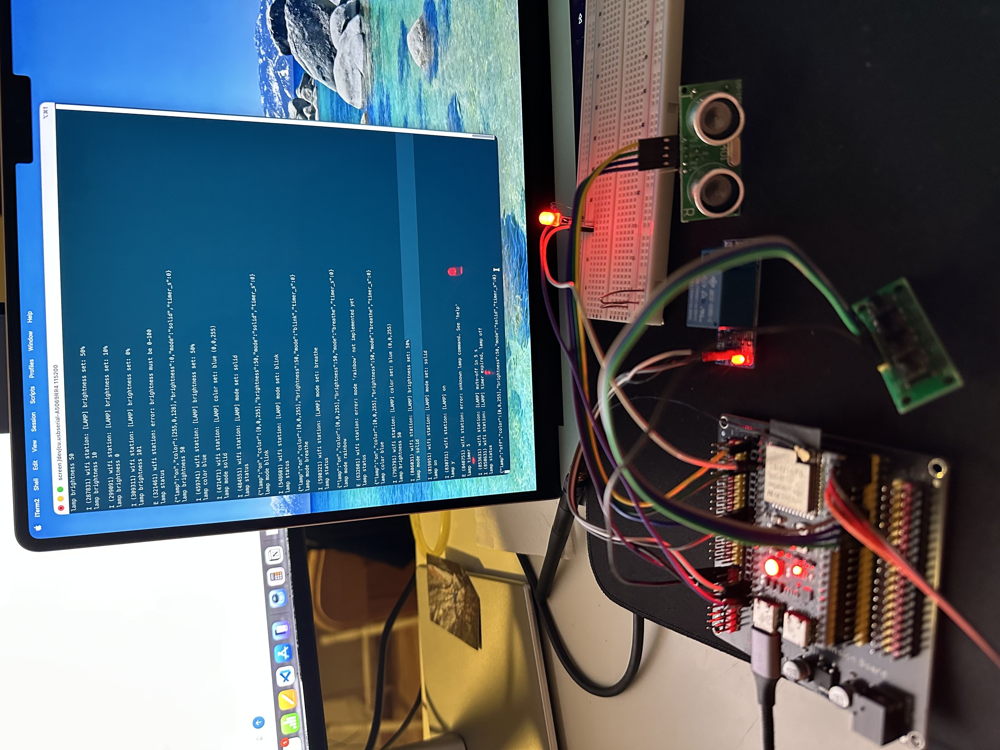
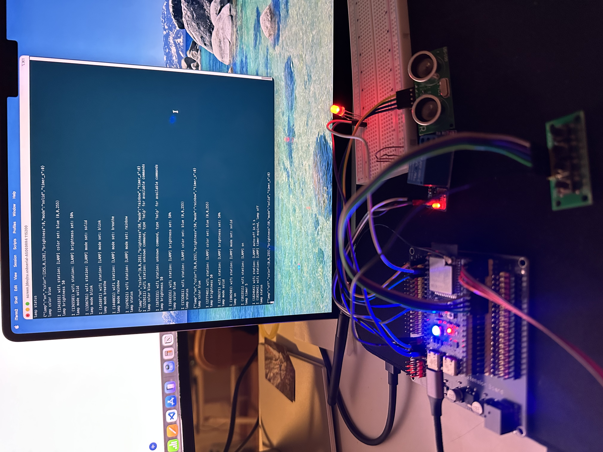

-   **Status:** Open in v1.5.0.

### BUG-04 --- OTA cannot be restarted after interrupted download without reboot

-   **Found in:** v1.3.0
-   **v1.4.0:** fixed
-   **v1.5.0:** reproduced again --- **regression**
-   **Severity:** Major
-   **Priority:** High
-   **PRD:** OTA-6
-   **Preconditions:** connected to Wi-Fi; OTA download available/in
    progress.
-   **Steps to reproduce:**
    1.  Start OTA.
    2.  During `[OTA] progress`, disconnect Wi-Fi using K3.
    3.  Wait for `[OTA] failed: download interrupted (ESP_FAIL)`.
    4.  Reconnect Wi-Fi without rebooting.
    5.  Retry the OTA command.
-   **Expected:** the next OTA attempt starts immediately without
    reboot.
-   **Actual:**
    -   v1.3.0: retry returns `[OTA] error: update already in progress`.
    -   v1.4.0: retry starts normally and completes successfully.
    -   v1.5.0: retry again returns
        `[OTA] error: update already in progress`.
-   **Reproducibility:** reproduced on v1.3.0 and again on v1.5.0.
-   **Evidence:**
    -   `evidence/BUG-04_ota_retry_after_interruption_v1.3.0.png`
    -   `evidence/BUG-04_ota_retry_after_interruption_v1.5.0.png`
    -   [`OTA_v1.5.0_interruption_retry.log`](logs/OTA_v1.5.0_interruption_retry.log)

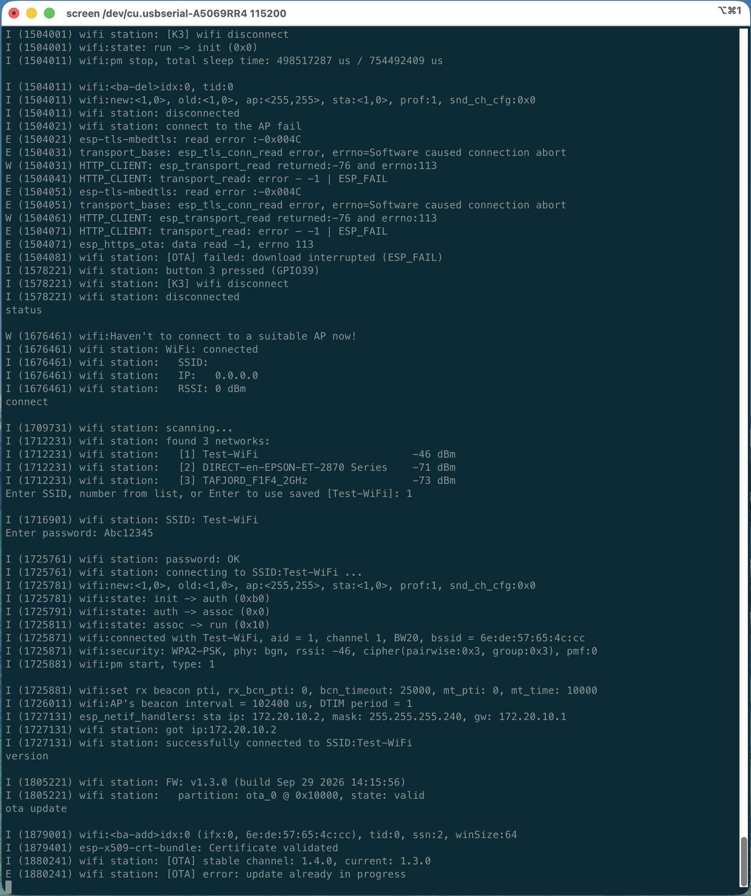
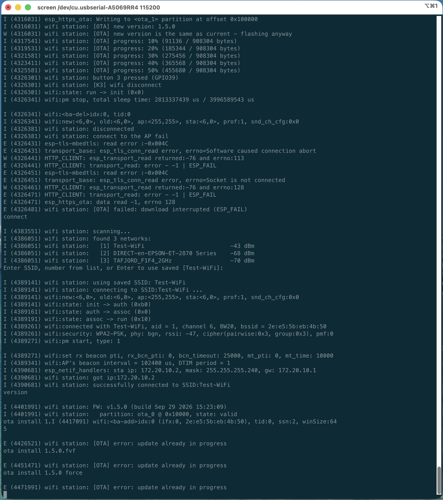

-   **Status:** Regression in v1.5.0.

### BUG-05 --- Configuration is lost after OTA update from v1.4.0 to v1.5.0

-   **Found during:** OTA `v1.4.0 -> v1.5.0`
-   **Severity:** Major
-   **Priority:** High
-   **PRD:** OTA-8
-   **Preconditions:**
    -   v1.4.0 connected to saved `Test-WiFi`.
    -   A non-default Smart Lamp configuration is saved before OTA.
    -   First run: purple `[160,0,255]`, brightness 30%, mode `blink`.
    -   Confirmation run: cyan `[0,255,255]`, brightness 45%, mode
        `blink`.
-   **Steps to reproduce:**
    1.  Configure the lamp and Wi-Fi on v1.4.0.
    2.  Perform successful `ota update beta` to v1.5.0.
    3.  Wait for reboot and `self-check passed`.
    4.  Run `lamp status`.
    5.  Run `connect` and check whether the saved network/password are
        available.
-   **Expected:** Wi-Fi network and Smart Lamp settings persist across
    successful OTA.
-   **Actual:** after updating to v1.5.0 the lamp settings reset to
    defaults (`white`, 50%, `solid`) and the previously saved Wi-Fi
    credentials are lost, requiring network selection/password entry
    again.
-   **Additional observation:** after configuring Wi-Fi again on v1.5.0,
    the credentials survive an ordinary reboot. Therefore the observed
    loss is associated with the OTA transition rather than normal reboot
    persistence.
-   **Reproducibility:** reproduced on two separate successful
    `1.4.0 -> 1.5.0` OTA transitions with different non-default lamp
    settings. On the confirmation run, cyan `[0,255,255]`, brightness
    45%, and `blink` reset to white `[255,255,255]`, 50%, and `solid`.
    The saved Wi-Fi network was also lost and `connect` required network
    selection again.
-   **Evidence:**
    -   `evidence/BUG-05_settings_reset_and_red_LED_after_OTA_v1.5.0.jpg`
    -   `evidence/BUG-05_settings_reset_after_OTA_v1.5.0_repeat.png`
    -   `evidence/BUG-05_wifi_credentials_lost_after_OTA_v1.5.0_repeat.png`
    -   [`OTA_v1.4.0_to_v1.5.0.log`](logs/OTA_v1.4.0_to_v1.5.0.log)

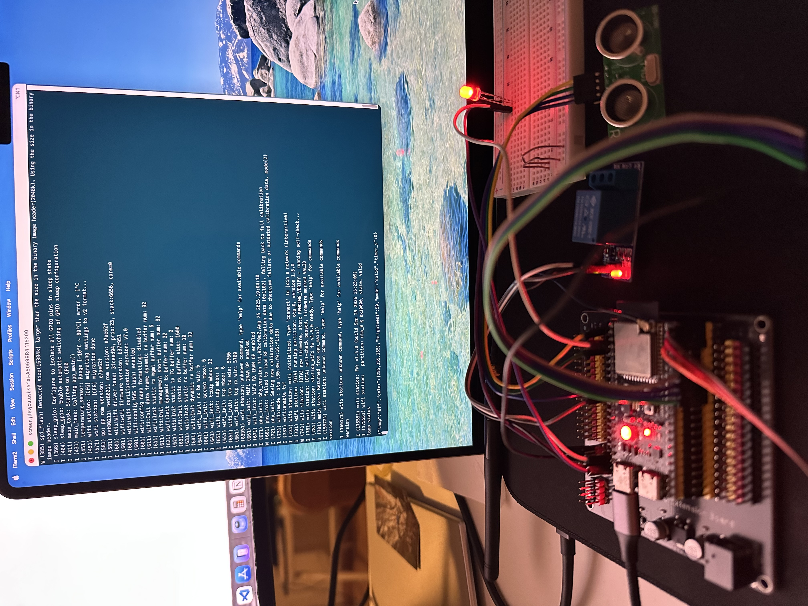
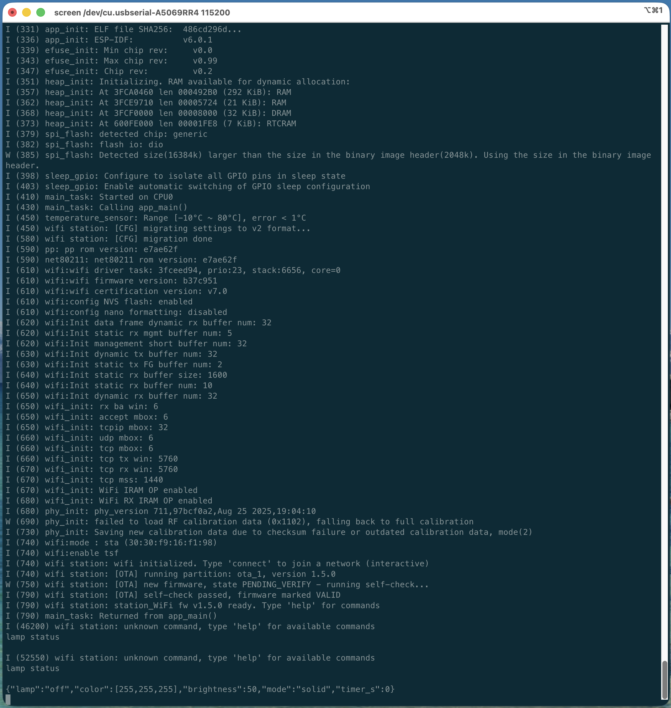
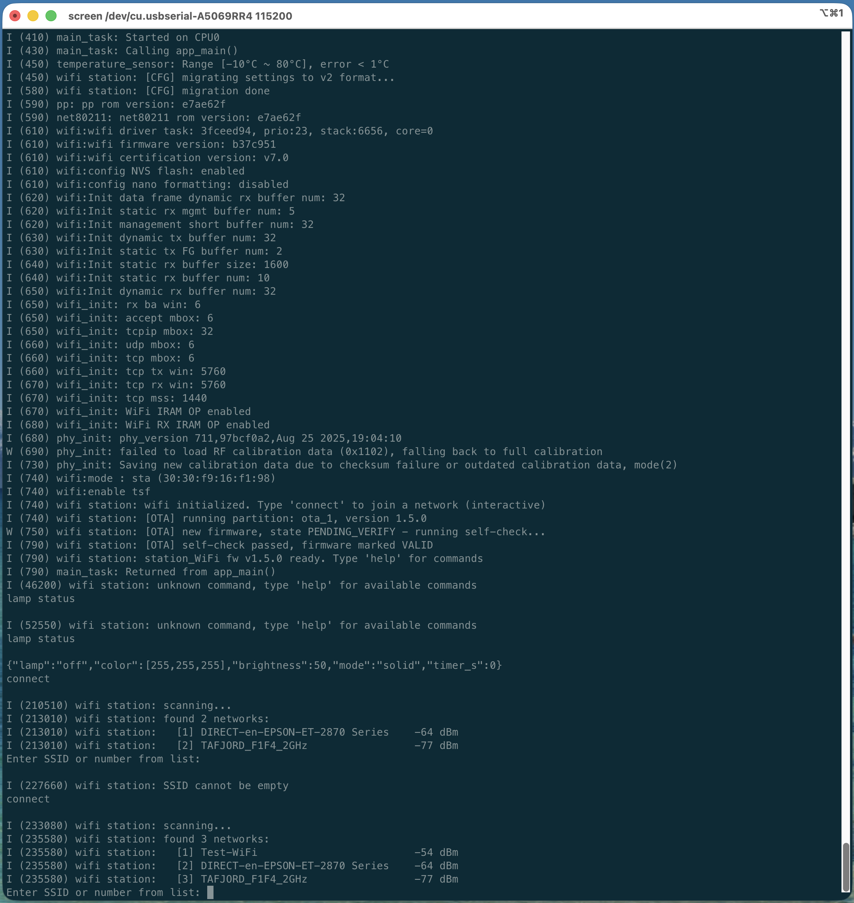

-   **Status:** Open in v1.5.0.

## 3. Bug matrix

| Bug | v1.3.0 | v1.4.0 | v1.5.0 | Notes |
|---|---|---|---|---|
| **BUG-01** RGB R/G channels swapped | FAIL | PASS / Fixed | PASS / Fixed | Fixed since 1.4.0 |
| **BUG-02** Brightness values outside 0–100 accepted | FAIL | PASS / Fixed | PASS / Fixed | Fixed since 1.4.0 |
| **BUG-03** Physical LED does not return to expected Wi-Fi indication | FAIL | FAIL | FAIL | Still open |
| **BUG-04** OTA retry after interruption | FAIL | PASS / Fixed | **FAIL / Regression** | Returned in 1.5.0 |
| **BUG-05** Configuration lost during OTA | N/A | N/A* | FAIL | Found on 1.4.0 → 1.5.0 |

\* BUG-05 is associated with the transition into v1.5.0. The previous
`1.3.0 -> 1.4.0` transition preserved the tested configuration
successfully.

### Regression summary

-   **BUG-04 is a confirmed regression in v1.5.0:** it is present in
    v1.3.0, fixed in v1.4.0, and returns in v1.5.0.
-   **BUG-05 is a new v1.5.0 OTA regression:** configuration that
    persisted successfully during `1.3.0 -> 1.4.0` is lost during
    `1.4.0 -> 1.5.0`.

## 4. OTA evidence/logs

Submitted cleaned logs:

-   [`OTA_v1.3.0_to_v1.4.0.log`](logs/OTA_v1.3.0_to_v1.4.0.log)
-   [`OTA_v1.4.0_to_v1.5.0.log`](logs/OTA_v1.4.0_to_v1.5.0.log)
-   [`OTA_v1.5.0_interruption_retry.log`](logs/OTA_v1.5.0_interruption_retry.log)
-   [`OTA_v1.5.0_to_v1.3.0_force.log`](logs/OTA_v1.5.0_to_v1.3.0_force.log)
-   [`OTA_rollback_broken_v1.3.0.log`](logs/OTA_rollback_broken_v1.3.0.log)

The rollback test successfully followed this sequence:

`v1.3.0 -> v1.9.0-broken -> PENDING_VERIFY -> self-check FAILED -> automatic rollback -> v1.3.0`

Wi-Fi passwords in submitted logs are redacted as `***`.

## 5. Conclusion

**Recommendation: v1.5.0 should NOT be promoted from beta to stable
yet.**

The release fixes the RGB channel issue (BUG-01) and invalid brightness
handling (BUG-02), and the new v1.5.0 features such as `rainbow` mode
and scenes work in the tested scenarios. Downgrade protection, forced
downgrade, firmware validation, and automatic rollback also work.

However, three release-blocking concerns remain:

1.  **BUG-03:** when Smart Lamp is OFF, the physical RGB LED does not
    reliably return to the expected Wi-Fi indication and may keep an
    incorrect Smart Lamp color.
2.  **BUG-04:** OTA recovery after Wi-Fi interruption regressed in
    v1.5.0. A retry without reboot can remain blocked by
    `update already in progress`.
3.  **BUG-05:** the `1.4.0 -> 1.5.0` OTA transition loses persistent
    Smart Lamp settings and saved Wi-Fi credentials, violating OTA-8.

BUG-04 and BUG-05 directly affect OTA reliability, which is the main
feature under test. These issues should be fixed and regression-tested
before v1.5.0 is promoted to stable.
